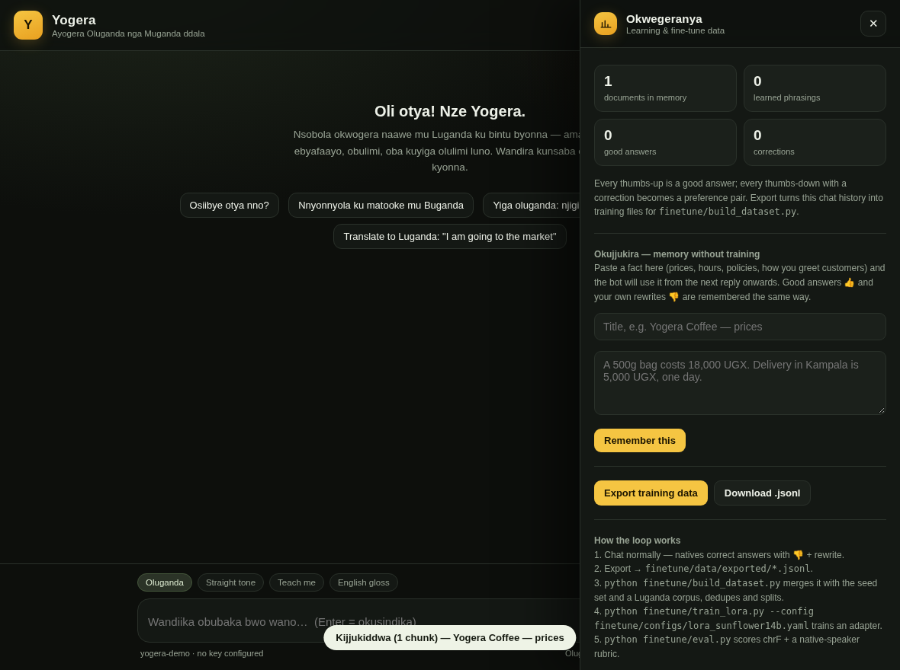

# Yogera — a Luganda chatbot that answers like a Muganda

A working Luganda chat app (web UI + REST API), plus the fine-tuning pipeline that turns
real conversations into a model that actually speaks the language instead of translating into it.

```
┌─────────────────────────────────────────────────────────────────────────┐
│  web/index.html          chat UI · streaming · thumbs up/down · correction box
├─────────────────────────────────────────────────────────────────────────┤
│  app/main.py             FastAPI: /api/chat (SSE), /api/chat/sync, /api/feedback,
│                          /api/export  →  conversations become training data
│  app/prompts.py          the Luganda system prompt: register, noun classes,
│                          orthography, greetings, refusal policy, few-shots
│  app/providers.py        OpenAI · Anthropic · Gemini · any OpenAI-compatible
│                          endpoint (vLLM/Ollama/OpenRouter) · offline demo
│  app/store.py            SQLite: conversations, messages, feedback, exports
├─────────────────────────────────────────────────────────────────────────┤
│  finetune/               ingest_hf → validate → build → train_lora (QLoRA)
│                          → train_dpo → eval (chrF++ / BLEU / judge / human sheet)
└─────────────────────────────────────────────────────────────────────────┘
```


<table><tr>
<td></td>
<td></td>
</tr></table>

## 60-second start

```bash
cd yogera
pip install -r requirements.txt      # fastapi, uvicorn, httpx, pydantic
cp .env.example .env                 # then paste ONE api key into it
./run.sh                             # http://localhost:8000
```

No key? It still runs — a small offline demo replies in Luganda and the UI says **demo mode**,
so you can test the interface, the feedback loop and the export before you spend anything.

**Fastest way to a genuinely good Luganda model today:** point it at a strong frontier model,
not at a small fine-tune.

**No GPU? You do not need one to make it learn.** Two of the four learning routes run on a
laptop: retrieval + memory (below) and hosted fine-tuning. See `TRAINING-OPTIONS.md`.

```env
# .env
LLM_PROVIDER=openai
LLM_MODEL=gpt-4.1-mini
OPENAI_API_KEY=sk-...
```

Then, when you want the model to sound like *your* Luganda — the register, the greetings, the
vocabulary of your users — run the loop in `finetune/README.md`.

## It learns without a GPU (the default path)

`app/knowledge.py` gives the bot a memory that is not weights:

- **Facts.** Paste your prices, hours, policies or FAQ into the knowledge base (UI: 📈 drawer →
  *Okujjukira*, or `POST /api/knowledge`). Retrieved with SQLite FTS5 + BM25 — no vector database,
  no dependencies, works offline.
- **Preferred phrasing.** A 👍 stores that answer as an approved phrasing; a 👎 with your rewrite
  stores *your* version. Similar questions retrieve them, so the bot reuses what a Muganda
  actually approved instead of inventing a new sentence.
- **A Luganda↔English glossary** bridges the language gap in retrieval: ask `ssente mmeka ku
  mmwanyi?` and the English line "a 500g bag costs 18,000 UGX" still matches.

Nothing is retrained, yet behaviour changes from the next message onwards. When you have enough
corrections to be worth a training run, that same data is already in `finetune/data/exported/`.

```bash
curl -X POST localhost:8000/api/knowledge -H 'content-type: application/json' \
  -d '{"title":"Prices","text":"A 500g bag costs 18,000 UGX. Delivery in Kampala is 5,000 UGX."}'
curl "localhost:8000/api/knowledge/search?q=ssente%20mmeka"
```

| Route | GPU | Cost | Use it for |
|---|---|---|---|
| Retrieval + memory (this) | none | $0 | Facts, policies, your voice — starts working today |
| Hosted fine-tune (`finetune/train_openai.py`) | none | a few $ | Behaviour, register, tone |
| Free Colab T4 (`finetune/colab_qlora.ipynb`) | free T4 | $0 | An 8B adapter you can run locally |
| Rented GPU (`finetune/train_lora.py`) | A100 40 GB | ~$3–6/run | Sunflower-14B, best Luganda, in-house |

Full comparison, honest costs and limits: **`TRAINING-OPTIONS.md`**.

## Why it sounds native (and where it still doesn't)

The quality of a low-resource-language chatbot is mostly prompt and data engineering, so
`app/prompts.py` is a serious document, not three lines:

| Decision | Why it matters in Luganda |
|---|---|
| Default to Luganda **only**, never code-mixed | The usual failure is an English word slipping in where `obudde`, `essimu` or `obuyambi` exists |
| Register control (`peer` vs `respect`) | `Oli otya?` to an elder is rude; you need `Muli mutya?` and plural `-mu-` concords |
| Noun-class concord tables in the prompt | `abantu babiri` vs `ebintu bibiri` vs `ennyumba nnya` — this is what marks a native speaker |
| Greeting-by-time-of-day with correct answers | `Wasuze otya? → Nzuze bulungi`, `Osiibye otya? → Nsibye bulungi`, and the plural forms |
| Orthography rules (geminates, apostrophes, no `ŋ`) | `ssomero`, `ennyumba`, `w'omuntu` — doubled consonants change meaning (`okukola` vs `okukoola`) |
| "Never word-for-word translate English idiom" | Literal translation is the clearest tell of a non-native speaker |
| Refuse to invent facts, words, prices, dates | Hallucination is the documented weak spot of Ugandan-language models |
| Answer short, ask one clarifying question | Luganda chat is conversational; essays read as machine output |

It will still get things wrong. **Every seed record in `finetune/data/` is marked
`"verified": false`** on purpose: get two or three native speakers to go through them with the
`human_rubric.csv` sheet before you trust or train on any of it.

## API

| Method | Path | What it does |
|---|---|---|
| `POST` | `/api/chat` | Streaming reply (SSE: `meta`, `delta`, `error`, `done`) |
| `POST` | `/api/chat/sync` | Same thing, one JSON response |
| `POST` | `/api/feedback` | `{message_id, conversation_id, rating: 1|-1, corrected_text}` |
| `GET` | `/api/conversations[/{id}]` | History |
| `DELETE` | `/api/conversations/{id}` | Forget a thread |
| `POST` | `/api/export` | Write `finetune/data/exported/{chats_sft,chats_dpo}.jsonl` |
| `GET` | `/api/export/download` | Download the SFT file |
| `GET`/`POST` | `/api/settings` | Inspect or switch provider/model/key at runtime (memory only) |
| `POST`/`GET`/`DELETE` | `/api/knowledge` | Add / list / remove documents the bot must remember |
| `GET` | `/api/knowledge/search?q=` | Preview exactly what retrieval would inject for a question |
| `GET` | `/api/health` | Provider status + usage stats |

```bash
curl -s localhost:8000/api/chat/sync -H 'content-type: application/json' \
  -d '{"message":"Osiibye otya nno?","register":"respect"}' | jq -r .reply
```

Request fields for `/api/chat`: `message`, `conversation_id?`, `language` (`lug`|`en`),
`tone` (`auto`|`peer`|`respect`), `teach_mode` (bool — adds an English gloss + grammar note),
`english_gloss` (bool), `temperature?`.

## Providers

Set one of these in `.env` (or live in the UI's settings drawer):

```env
LLM_PROVIDER=openai|anthropic|gemini|compatible|mock
LLM_MODEL=...
LLM_BASE_URL=...        # for compatible endpoints
LLM_TEMPERATURE=0.6
LLM_MAX_TOKENS=900
```

`compatible` is the interesting one: point it at a vLLM/Ollama server running Sunbird's
**Sunflower-14B** (`Sunbird/Sunflower-14B`) and you get a Luganda-first model with no data
leaving your machine. That is the end state of the fine-tuning work.

## Tests

```bash
pytest -q       # 14 tests, offline, ~1s: API, streaming, feedback→export, chrF/BLEU, dataset validation
```

## Layout

```
yogera/
├─ app/          FastAPI backend, Luganda prompts, providers, SQLite store
├─ web/          single-file chat UI (no CDN, no build step)
├─ finetune/     ingest · validate · build · train_lora · train_dpo · train_openai · eval
│               + colab_qlora.ipynb (free T4) + its own README
├─ TRAINING-OPTIONS.md   six ways to train, ranked by cost — two need no GPU
├─ AGENTS.md     brief for whatever coding agent opens this repo next
├─ tests/
├─ .env.example  five provider recipes
├─ requirements.txt  Makefile  run.sh
```

## Honest limitations

- **Luganda is low-resource.** A frontier model with a good prompt is fluent-ish but still makes
  agreement errors; a small fine-tune on 1,000 rows will be *worse*, not better. The pipeline here
  is designed to grow into a real dataset, not to pretend 26 seed rows are one.
- **Retrieval is keyword-based, not semantic.** FTS5 + a glossary handles Luganda/English keyword
  overlap, not paraphrase. If users ask things in many different ways, add embeddings later —
  `app/knowledge.py:search_documents` is the one function to swap.
- **Text only.** Luganda users overwhelmingly prefer voice. Sunbird ships usable
  `asr-whisper-large-v3-salt` and `tts-vits-lug` models — voice input is the highest-impact next step.
- **Demo mode is not a model.** With no key, replies are keyword-routed canned lines so the UI and
  the learning loop can be tested. It is labelled `demo` everywhere for that reason.

## Roadmap that would matter most

0. **Native-review tool** — a page that loads the review queue and flips `verified: true`. It is
   the bottleneck for every other improvement.
1. **Voice** — Whisper-Luganda for input, VITS-Luganda for output (both public on the Hub).
2. **WhatsApp/USSD front-end** — where Ugandan users actually are.
3. **RAG over your documents** — support and health content in Luganda, grounded, not guessed.
4. **Native-speaker review tool** — a small page that loads the review queue and writes
   `verified: true`; it is the bottleneck for every other improvement.

Licence: your call — the seed data is ours to give, the corpora you ingest are not (see
`finetune/README.md` for per-dataset licences).
